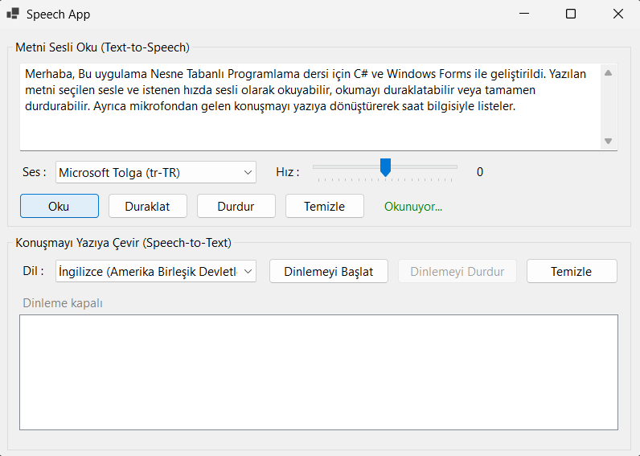
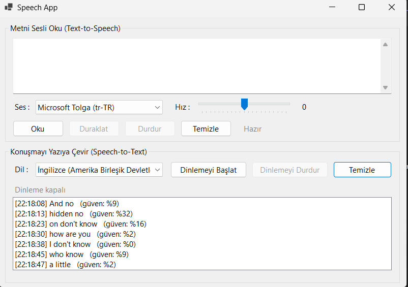

# YMH219-SpeechApp — Speech-to-Text ve Text-to-Speech

Nesne Tabanlı Programlama (YMH 219) dersi için C# ve Windows Forms ile geliştirilmiş, ses ile metin arasında çift yönlü dönüşüm yapan uygulama.

- **Text-to-Speech:** Yazılan metni seçilen sesle ve istenen hızda sesli okur.
- **Speech-to-Text:** Mikrofondan gelen konuşmayı yazıya çevirir ve zaman bilgisiyle listeler.

## Ekran Görüntüleri

| Metni sesli okuma | Konuşmayı yazıya çevirme |
|:---:|:---:|
|  |  |

## Kullanılan Teknolojiler

- C# / .NET 10 (`net10.0-windows`)
- Windows Forms
- NuGet: **System.Speech** (10.0.15)
  - `System.Speech.Synthesis.SpeechSynthesizer` (metin okuma)
  - `System.Speech.Recognition.SpeechRecognitionEngine` + `DictationGrammar` (konuşma tanıma)

## Kurulum ve Çalıştırma

1. Depoyu klonlayın:
```
   git clone https://github.com/cenaismail/YMH219-SpeechApp.git
```
2. `SpeechApp/SpeechApp.slnx` dosyasını Visual Studio ile açın (.NET 10 SDK gereklidir). NuGet paketi derleme sırasında otomatik indirilir.
3. **F5** ile çalıştırın.
4. Speech-to-Text için bilgisayarda mikrofon bulunmalı ve Windows gizlilik ayarlarında uygulamaların mikrofona erişimine izin verilmelidir.

## Temel Özellikler

**Text-to-Speech**
- Bilgisayarda yüklü sesler listelenir; Türkçe ses (ör. Microsoft Tolga) varsa otomatik seçilir
- **Oku**, **Duraklat / Devam Et**, **Durdur** ve **Temizle** işlevleri
- Hız ayarı (-10 / +10); okuma sürerken değiştirilirse okuma kaldığı kelimeden yeni hızla devam eder
- Durum göstergesi: Hazır / Okunuyor / Duraklatıldı

**Speech-to-Text**
- Bilgisayarda yüklü konuşma tanıma dilleri listelenir
- **Dinlemeyi Başlat**, **Dinlemeyi Durdur** ve **Temizle** işlevleri
- Tanınan her cümle saat ve güven oranıyla listelenir
- Durum göstergesi: Dinleniyor / Dinleme kapalı

**Hata yönetimi**
- Hoparlör/ses yoksa, mikrofona erişilemezse veya konuşma tanıma motoru bulunamazsa anlaşılır bir mesaj gösterilir; uygulama kapanmaz.

## Proje Yapısı ve Sınıflar

```
SpeechApp/
├── TextToSpeechService.cs   Metin okuma: ses seçimi, hız, oku/duraklat/durdur
├── SpeechToTextService.cs   Konuşma tanıma: dinlemeyi başlat/durdur, tanınan metni bildir
├── Form1.cs                 Arayüz: iki bölüm, butonlar ve durum göstergeleri
└── Program.cs               Uygulamanın giriş noktası
```

**Tasarım notları**

- Ses işlemleri form dışında iki ayrı servis sınıfındadır; form bu sınıfların olaylarını (`StateChanged`, `SpeakError`, `TextRecognized`, `ListeningStopped`) dinler.
- Her iki servis `IDisposable` arayüzünü uygular; form kapanırken ses kaynakları serbest bırakılır.
- Ses motorunun olayları farklı iş parçacığından gelebileceği için arayüz güncellemeleri `Invoke` ile ana iş parçacığında yapılır.

## Bilinen Sınırlamalar / Geliştirme Notları

- `System.Speech` yalnızca Windows'ta çalışır.
- Windows'un masaüstü konuşma tanıyıcısı genellikle yalnızca **İngilizce** destekler; Türkçe konuşma tanınamaz.
- Tanıyıcı eğitilmeden kullanıldığı için dikte doğruluğu düşüktür; mikrofon kalitesi, aksan ve ortam gürültüsü sonucu belirgin şekilde etkiler. Daha yüksek doğruluk için ileride `Windows.Media.SpeechRecognition` gibi daha yeni bir altyapı kullanılabilir.
- Tanınan metin dosyaya kaydedilmez.

## Öğrenci

- **Ad Soyad:** Cena İsmail
- **Öğrenci No:** 250541615